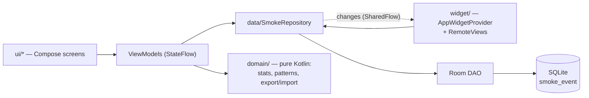

<p align="center">
  
</p>

<h1 align="center">SmokeTracker</h1>

<p align="center">
  <b>Log a cigarette with one tap. See your patterns. Nothing leaves your phone.</b>
</p>

<p align="center">
  <a href="LICENSE"></a>
  
  
  
  <a href="https://github.com/SyscallBrain/SmokeTracker/releases/latest"></a>
</p>

SmokeTracker is a small, offline Android app for counting cigarettes. Tap **+1** — in the app or
on a home-screen widget — and it shows how many today, how long since the last one, and where
your habit clusters by hour and weekday.

> The app's user interface is in **European Portuguese**. This README is in English; there is a
> short [Portuguese section](#em-português) at the end.

## Why

- **One tap, no friction.** Logging has to be faster than thinking about it, or it doesn't happen.
  The widget logs without opening the app and without a confirmation dialog.
- **No goals, no judgement.** No targets, streaks, badges or "you failed" messages. It's a mirror,
  not a coach: numbers and charts, nothing else.
- **Your data is yours.** No account, no cloud, no network permission. Export everything to
  CSV/JSON whenever you like, and import it back.

## Features

**Today**
- Large count for today, "last one … ago" (refreshed every minute) and a big **+1** button with
  haptic feedback.
- Snackbar "Registado às HH:MM · Desfazer" for 5 s — *undo* deletes exactly the event just added.
- Cards: 7-day average per day (up to yesterday, with % change vs. the previous 7 days) and
  average interval between cigarettes today.
- Today's cigarettes by hour (bar chart).

**Statistics** — periods of **7 days · 30 days · 90 days · 1 year**
- Cards: total, average per day (with % change vs. the previous period), worst day, and average
  interval (within the same day).
- Daily bars with a 7-day moving average (7/30 days) or weekly bars (90 days / 1 year).
- Distribution by hour of day (0–23).
- **Heatmap hour × weekday** (Monday first).

**History**
- Events grouped by local day, loaded 30 days at a time.
- Swipe to delete, with *undo* (restores the same instant and time zone).
- Add a forgotten cigarette with a Material 3 date picker + 24 h time picker; future times are
  blocked.
- **Export** all events to **CSV** or **JSON** through the system file picker (you choose where
  the file goes: Downloads, a cloud-drive app, …). Suggested name `smoketracker-YYYY-MM-DD.csv|json`.
- **Import JSON** (a previous export). The whole file is validated first — **all or nothing** —
  with a readable error pointing at the offending record ("registo n.º 3: instante no futuro …").
  Duplicates (same instant to the millisecond and same time zone) are skipped, so importing the
  same file twice adds nothing. A dialog shows how many events are new and how many already
  exist before anything is written.

**Home-screen widget** (2×1)
- Today's count, "último HH:MM" (absolute time — a widget can't refresh every minute) and a
  **+1** button.
- Refreshes on every change (from the app, the widget or an import) and at local midnight.
- Optional vibration and an optional toast "Registado às HH:MM · N hoje".

**Settings**
- Vibrate on log (on/off) and vibration type (short / double / strong) with a *test* button.
- Show the message when logging from the widget (on/off).
- Notification status with a shortcut to allow them (Android 13+ needs it for the widget toast to
  appear while the app is in the background).

**Look & feel**
- Always dark, **Tokyo Night** palette, Material 3, no dynamic colour.

**Time zones done right**
- Every event stores the UTC instant *and* the IANA time zone where it was logged. A "day" is the
  local calendar day of that zone, so clock changes and travel don't scramble your history — e.g.
  the two distinct 01:30s on 25 Oct 2026 in Lisbon are kept, in the right order.

## Privacy

SmokeTracker has **no `INTERNET` permission**: it cannot send your data anywhere, by
construction. No account, no analytics, no ads, no crash reporter, no third-party SDK that phones
home.

- Events are stored only in a local **Room (SQLite)** database in the app's private storage.
- Settings live in a local **DataStore** file.
- Export/import use the Storage Access Framework, so the app needs **no storage permission**: it
  only touches the file you pick.

Complete permission list of the 1.0.0 release APK (`aapt2 dump badging`):

| Permission | Why |
|---|---|
| `VIBRATE` | Haptic confirmation when you tap **+1** on the widget. |
| `POST_NOTIFICATIONS` | Android 13+ hides toasts from background apps without it; used only for the widget's "Registado às …" message. Requested from Settings; optional. |
| `WAKE_LOCK` | Merged from **WorkManager** (used for the widget's midnight refresh). |
| `ACCESS_NETWORK_STATE` | Merged from **WorkManager** (supports network constraints, which this app doesn't use). It only reads connectivity state — it does **not** grant network access. |
| `RECEIVE_BOOT_COMPLETED` | Merged from **WorkManager** so the scheduled midnight refresh survives a reboot. |
| `FOREGROUND_SERVICE` | Merged from **WorkManager**; not used by the app's own code. |
| `pt.tiago.cinzeiro.DYNAMIC_RECEIVER_NOT_EXPORTED_PERMISSION` | Internal signature-level permission generated by AndroidX Core for non-exported runtime receivers. Other apps can't hold it. |

All are *normal* permissions granted at install, except `POST_NOTIFICATIONS`, which you may leave
off.

> **Device backups:** the manifest doesn't set `android:allowBackup`, so if you use Android's own
> device backup, the system may include the app's data in it. The app itself never uploads
> anything.

## Install

SmokeTracker is **not on Google Play**. Download the signed APK from the
[latest GitHub Release](https://github.com/SyscallBrain/SmokeTracker/releases/latest) and
sideload it (allow "install unknown apps" for your browser or file manager).

Verify the download before installing:

```bash
sha256sum smoketracker-1.0.0.apk                  # compare with the hash in the release notes
apksigner verify --print-certs smoketracker-1.0.0.apk
```

Expected output (the APK uses APK Signature Scheme v2, RSA 4096):

```
V2 Signer: certificate DN: CN=SmokeTracker
V2 Signer: certificate SHA-256 digest: 5d904c7fd637f52f6841ed5d3e15ebc62b1127ed9e13cf7f6b20c8bd978f3265
```

Future releases will be signed with the same key; Android refuses an update signed with a
different one.

> Switching between a self-built debug APK and the release APK requires uninstalling (different
> signatures), which deletes the app's data. **Export to JSON first**, then import it after
> reinstalling.

## Data format

Both formats contain **all** events, ordered by instant. `local_datetime` is redundant (derived
from `instant_utc` + `zone_id`) and is there for spreadsheets; the importer ignores it and the
`id` values.

**CSV** — RFC 4180, UTF-8 without BOM, `,` separator, `\n` line endings:

```csv
id,instant_utc,zone_id,local_datetime
1,2026-09-29T12:32:05Z,Europe/Lisbon,2026-09-29T13:32:05
```

**JSON** — versioned; this is what the importer reads:

```json
{
  "format": "cinzeiro-export",
  "version": 1,
  "exported_at": "2026-09-29T13:40:00Z",
  "app_version": "1.0.0",
  "count": 1,
  "events": [
    {"id": 1, "instant_utc": "2026-09-29T12:32:05Z", "zone_id": "Europe/Lisbon", "local_datetime": "2026-09-29T13:32:05"}
  ]
}
```

Import rules: `format` must be `cinzeiro-export`, `version` must be `1`, `count` must equal the
number of events, every `instant_utc` must be ISO-8601 and not in the future, and every `zone_id`
must be a known IANA zone. Unknown keys are ignored. Any error → nothing is imported.

A synthetic 13-event example: [`app/src/test/resources/sample-export-v1.json`](app/src/test/resources/sample-export-v1.json).

## Build from source

Requirements: **JDK 21** (e.g. the JetBrains Runtime bundled with Android Studio) and the
**Android SDK** with platform `android-37.2` and build-tools 37.

```bash
export JAVA_HOME=/path/to/jdk-21
export ANDROID_HOME=/path/to/android-sdk     # or sdk.dir=… in local.properties (git-ignored)

./gradlew assembleDebug          # → app/build/outputs/apk/debug/app-debug.apk
./gradlew testDebugUnitTest      # JVM + Robolectric unit tests, no device needed
./gradlew lintDebug
```

The debug build has a hidden developer menu (long-press the date on the Today screen) to generate
90 days of synthetic data or wipe everything. It is compiled into the debug variant only.

### Release build

The release is signed with its own key, never the debug key. The signing values come from four
Gradle properties kept **outside** the repository (e.g. in `~/.gradle/gradle.properties`):

```properties
SMOKETRACKER_STORE_FILE=/path/to/release.jks
SMOKETRACKER_STORE_PASSWORD=…
SMOKETRACKER_KEY_ALIAS=…
SMOKETRACKER_KEY_PASSWORD=…
```

```bash
./gradlew assembleRelease        # → app/build/outputs/apk/release/app-release.apk
```

If any property is missing, the `checkReleaseSigning` task fails with a clear message instead of
producing an unsigned or debug-signed APK. Debug builds and tests don't need these properties.

[`tools/make-release-keystore.sh`](tools/make-release-keystore.sh) is a one-off helper that
generates a PKCS12 keystore (RSA 4096, `CN=SmokeTracker`) with a random password, backs up the
password and the `.jks` to a Bitwarden vault (`bw` CLI; works with free accounts) and appends the
four properties to `~/.gradle/gradle.properties`. It refuses to run if a keystore already exists.
You can just as well create a keystore with `keytool` and set the properties yourself — a fork
must use its **own** key.

## Tech stack

| Piece | Version |
|---|---|
| Kotlin (Compose + serialization compiler plugins) | 2.4.20 |
| Android Gradle Plugin (built-in Kotlin support) | 9.4.1 |
| Gradle wrapper | 9.8.0 |
| KSP | 2.3.12 |
| Jetpack Compose BOM — Material 3, material-icons-extended | 2026.09.00 |
| Activity Compose | 1.13.0 |
| Navigation Compose (type-safe routes) | 2.10.2 |
| Lifecycle (runtime / ViewModel Compose) | 2.11.0 |
| Room (schema exported to `app/schemas/`) | 2.8.5 |
| DataStore Preferences | 1.2.1 |
| WorkManager | 2.12.0 |
| Vico charts (`compose-m3`) | 3.3.1 |
| kotlinx-serialization-json | 1.11.0 |
| core-ktx | 1.19.1 |
| Tests: JUnit · Robolectric · androidx.test core · kotlinx-coroutines-test | 4.13.2 · 4.17 · 1.7.0 · 1.11.0 |

`compileSdk` 37.2 · `targetSdk` 36 · `minSdk` 26 (Android 8.0) · JVM target 17.
No DI framework — a small hand-written `AppContainer`.

## Architecture

A single Gradle module (`:app`), layered by package:



- **`domain/`** is plain Kotlin on `java.time` with **no `android.*` imports**: counts, summaries
  (per-day average, deltas, worst day, intervals), hour/weekday patterns, the CSV/JSON exporters
  and the JSON importer. Statistics are computed in memory from the events of the requested range,
  not with SQL aggregates, and are unit-tested on the JVM.
- **`data/`** — Room entity and DAO, `SmokeRepository` (log now, log in the past, delete, import
  with dedupe in a single transaction) and a zone-aware system clock. One table:
  `smoke_event(id, at_epoch_ms, zone_id)` with an index on `at_epoch_ms`.
- **`ui/`** — Today, Statistics, History and Settings; each screen has a ViewModel exposing a
  `StateFlow`.
- **`widget/`** — a classic `AppWidgetProvider` with `RemoteViews`. Jetpack Glance was used first
  and dropped because on a real device it kept showing stale counts after the app had pushed new
  values.
- **`settings/`**, **`feedback/`** — DataStore-backed preferences; vibration and toast feedback.

## Project structure

```
app/src/main/java/pt/tiago/cinzeiro/
├── App.kt, MainActivity.kt, CrashLog.kt   # CrashLog only acts in debug builds
├── data/          # Room database, DAO, entity, SmokeRepository, clock
├── di/            # AppContainer (manual dependency wiring)
├── domain/        # pure Kotlin: Counts, Summary, Patterns, SmokeEvent
│   └── export/    # CsvExporter, JsonExporter, JsonImporter, models
├── feedback/      # vibration + widget toast
├── settings/      # Settings model, DataStore repository, vibration patterns
├── ui/            # today/, stats/, history/, settings/, nav/, components/, theme/, format/
└── widget/        # receiver, RemoteViews builder, state, midnight refresh (WorkManager)
app/src/debug/     # developer menu + synthetic data generator (debug APK only)
app/src/release/   # no-op stand-in for the debug tools
app/src/test/      # JVM + Robolectric unit tests, synthetic JSON fixture
app/schemas/       # exported Room schema (base for future migrations)
docs/icon.svg      # app icon, drawn from the adaptive-icon vector drawable
tools/             # make-release-keystore.sh
```

The package name `pt.tiago.cinzeiro` is the project's original working name (*cinzeiro* is
Portuguese for "ashtray"); changing an `applicationId` turns it into a different app for existing
installs, so it stays. The JSON format id `cinzeiro-export` stays for the same reason.

## Testing

`./gradlew testDebugUnitTest` runs **143 unit tests** on the JVM — no emulator or device: 120 plain
JUnit tests (domain logic, ViewModels, exporters/importer, formatting, settings, widget state) and
23 Robolectric tests (Room repository, widget receiver, crash-log files). Time-sensitive tests use
fixed clocks, including the 25 Oct 2026 clock change in Lisbon. The UI is tested by hand on a real
phone.

## Roadmap and non-goals

There is no fixed roadmap; small quality-of-life improvements may come.

Deliberate **non-goals**:
- Goals, limits, streaks, gamification or motivational messages.
- Accounts, cloud sync or any network access.
- Tracking brands, prices, triggers or notes.

## Contributing

Issues and pull requests are welcome. Keep changes small and focused, run
`./gradlew testDebugUnitTest lintDebug` before submitting, keep `domain/` free of Android
dependencies, and don't add the `INTERNET` permission or any tracking library. UI strings are in
European Portuguese.

## License

[MIT](LICENSE) © 2026 SyscallBrain

---

## Em português

**SmokeTracker** é uma app Android para registar cigarros com um toque (na app ou no widget) e ver
estatísticas: contagem de hoje, médias de 7/30/90 dias e 1 ano, distribuição por hora e mapa de
calor hora × dia da semana. Sem metas nem julgamentos. A interface está em português de Portugal.

Os dados ficam **só no telemóvel** (base de dados local): a app **não tem permissão `INTERNET`**,
nem contas, publicidade ou analytics. Pode exportar tudo para CSV ou JSON e voltar a importar o
JSON (validação completa, sem duplicados).

Instalação: descarregar o APK assinado da
[última release](https://github.com/SyscallBrain/SmokeTracker/releases/latest) (não está na Play
Store) e confirmar o SHA-256 do ficheiro e o do certificado
(`5d904c7fd637f52f6841ed5d3e15ebc62b1127ed9e13cf7f6b20c8bd978f3265`). Licença MIT.
